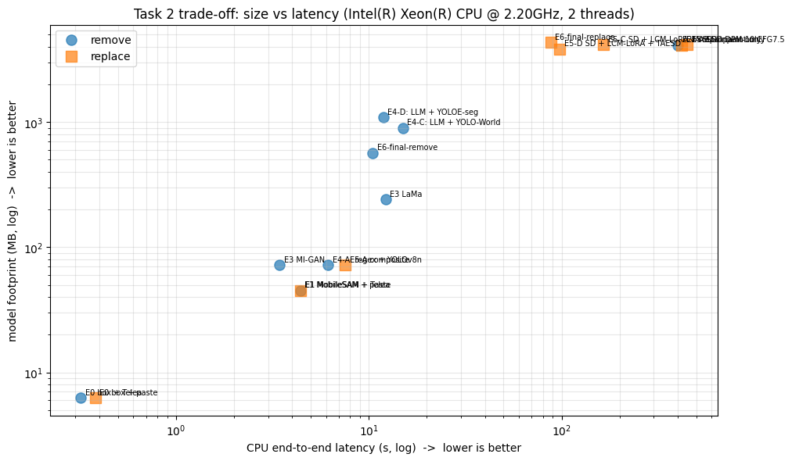
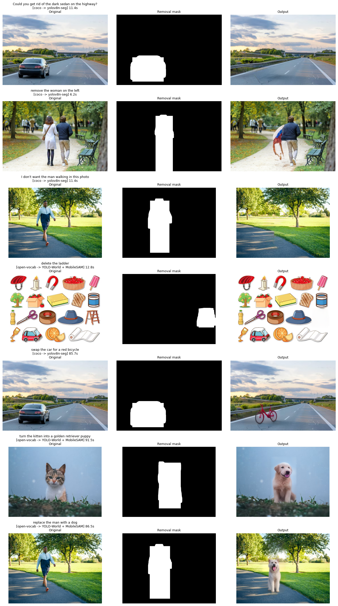
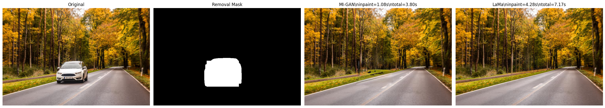
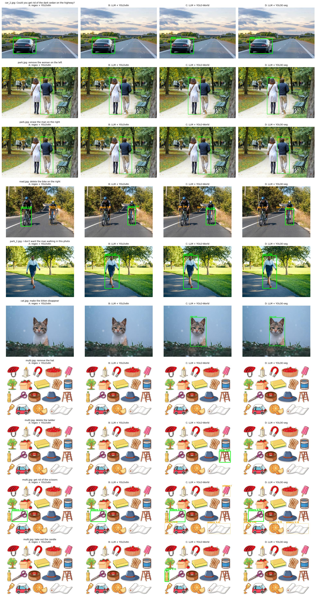
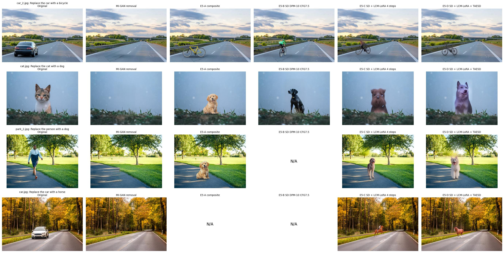
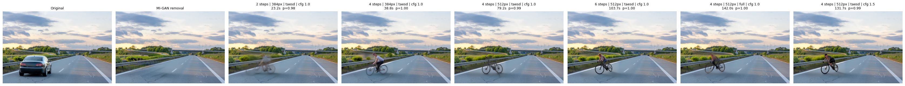
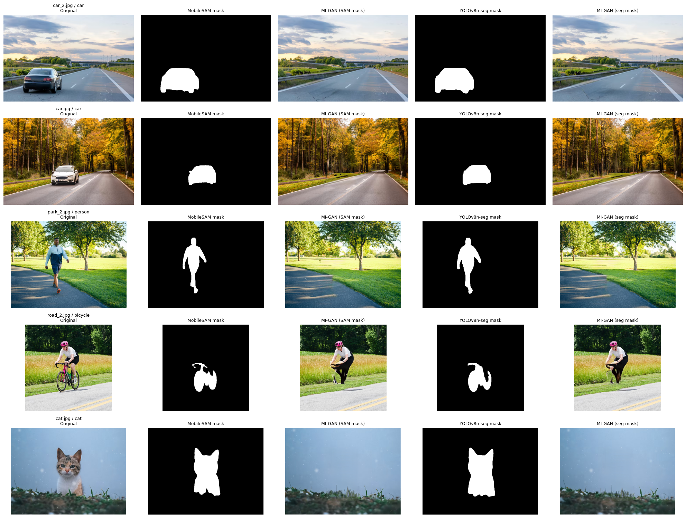
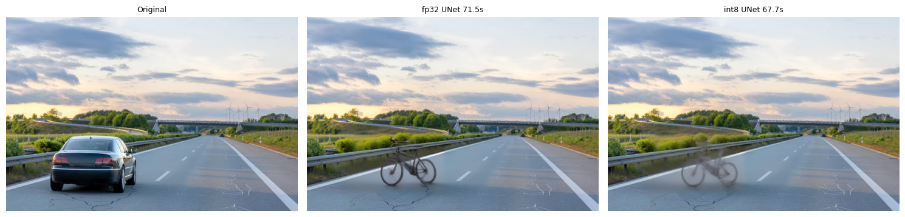
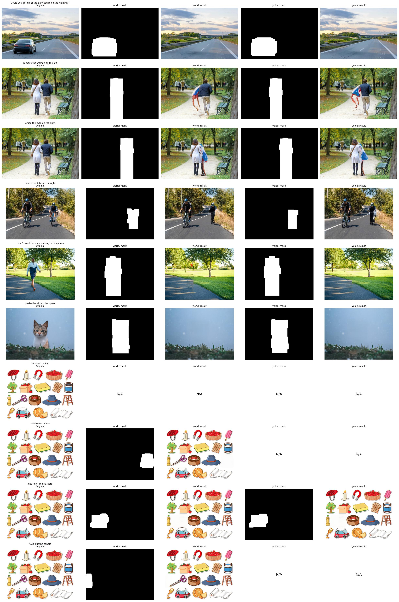

# Benchmark report

CPU inference time, model footprint and output quality for every experiment (E0–E6) and for the
final pipeline. Raw numbers: [`benchmarks/`](../benchmarks). Design rationale: [approach](approach.md).

## 1. Setup

| | |
|---|---|
| Hardware | Google Colab CPU runtime: Intel Xeon @ 2.20 GHz, **2 vCPU**, 12.7 GB RAM, no GPU |
| Software | Python 3.13, PyTorch 2.11 (CPU), ONNX Runtime 1.30, OpenCV 4.14, Ultralytics 8.4.166, diffusers 0.40, transformers 5.17, llama-cpp-python (CPU wheel) |
| Threads | 2 for PyTorch, OpenCV, ONNX Runtime and llama.cpp (E0–E3 used 1) |
| Inputs | 8 photos and one sticker sheet in [`data/samples/`](../data/samples); 26 parser instructions; 10 grounding instructions |

**Method**

* Wall-clock time per stage with `time.perf_counter`; one warm-up run, then 3 timed runs
  (1 timed run for diffusion variants and for the final cases). Means are reported.
* **Weights** = file on disk (`.pt`, `.onnx`, `.gguf`), or fp32 parameters × 4 bytes for the diffusers
  pipeline. The CLIP text encoder that YOLO-World downloads is counted.
* **Peak RAM** = RSS of the notebook process sampled every 10 ms. It includes every model resident at
  the time and the evaluation-only CLIP model, so it is an upper bound, not a deployment figure.
* **Quality**: before / after grids for every case. For replacement, CLIP ViT-B/32 zero-shot
  probability that the edited region shows the target rather than the old object or an empty
  background (evaluation only, not counted in any footprint).
* **Sessions.** The final pipeline was benchmarked in two Colab sessions: with the regex parser
  (`e6_regex_session/`) and with the LLM parser (`e6_llm_session/`). Shared vCPUs made the same code up
  to 2× slower in the second session, so comparisons are only made within one session.

## 2. All experiments

| Experiment | Task | CPU latency / image | Weights | Quality |
|---|---|---|---|---|
| E0 YOLOv8n box + Telea | remove | 0.32 s | 6.3 MB | poor: box-shaped smear |
| E0 box + paste | replace | 0.38 s | 6.3 MB | poor: pasted rectangle |
| E1 MobileSAM + Telea | remove | 4.43 s | 45.1 MB | poor: object-shaped smear |
| E2-A SD-1.5 inpainting (fixed prompt / mask) | remove | 400 s | 4.11 GB | clean, but the naive version regenerates the object |
| E2-A SD-1.5 inpainting | replace | 419 s | 4.11 GB | good when the old object does not leak |
| E3 MI-GAN | remove | 3.44 s | 71.9 MB | good on roads, grass, sky |
| E3 LaMa | remove | 12.2 s | 241 MB | best texture on large holes |
| E4-A regex + YOLOv8n | remove | 6.15 s ¹ | 71.9 MB | grounding 3/10 |
| E4-C LLM + YOLO-World | remove | 15.0 s | 897 MB | grounding 8/10 |
| E4-D LLM + YOLOE-seg | remove | 11.9 s | 1.09 GB | grounding 7/10 |
| E5-A erase + composite | replace | 7.5 s | 72.3 MB | real object, library only |
| E5-B erase + SD DPM 10 steps CFG 7.5 | replace | 449 s | 4.14 GB | good, drew a rider on "bicycle" |
| E5-C + LCM-LoRA, 4 steps | replace | 165 s | 4.14 GB | good |
| E5-D + TAESD | replace | 98 s | 3.83 GB | good, faint halo |
| **Final · remove, regex** (session 1) | remove | **1.8–1.9 s** | **33.5 MB** | as E3 |
| **Final · remove, LLM + open vocab** (session 2) | remove | **10.5 s** | **903 MB** | as E3 |
| **Final · replace** (session 2) | replace | **87.9 s** | **4.66 GB** | as E5-D |
| **Final · fast replace** (session 1) | replace | **3.0 s** | **33.9 MB** | as E5-A |

¹ only 1 of 4 benchmark instructions parsed and grounded; the others failed.



## 3. Final pipeline

### 3.1 Per-stage latency (session 2, LLM parser on)

| Stage | Remove (4 cases) | Replace (3 cases) |
|---|---|---|
| Parse · Qwen2.5-0.5B Q4 | 7.57 s | 9.39 s |
| Ground · YOLOv8n-seg / YOLO-World | 0.43 s | 0.95 s |
| Mask · same pass / MobileSAM | 0.87 s | 2.36 s |
| Remove · MI-GAN | 1.60 s | 2.36 s |
| Insert · SD-1.5 + LCM + TAESD | — | 72.82 s |
| **Total** | **10.47 s** | **87.89 s** |
| Peak RSS (whole process) | 8.9 GB | 9.5 GB |

Per case ([`final_pipeline_cases.csv`](../benchmarks/e6_llm_session/final_pipeline_cases.csv)):

| Instruction | Route | Time |
|---|---|---|
| "Could you get rid of the dark sedan on the highway?" | COCO → YOLOv8n-seg | 11.4 s |
| "remove the woman on the left" | COCO → YOLOv8n-seg | 6.2 s |
| "I don't want the man walking in this photo" | COCO → YOLOv8n-seg | 11.4 s |
| "remove the hat" | — | failed: not found |
| "delete the ladder" | open vocab → YOLO-World + MobileSAM | 12.8 s |
| "swap the car for a red bicycle" | COCO → YOLOv8n-seg | 85.7 s |
| "turn the kitten into a golden retriever puppy" | open vocab (fallback) | 91.5 s |
| "replace the man with a dog" | open vocab (fallback) | 86.5 s |

Session 1 (regex parser) ran the same removals in **1.76 s** and **1.93 s**; "I don't want the man…"
failed to parse and "remove the woman on the left" removed the man (regex has no notion of "left").



### 3.2 Footprint

| Component | Weights | Params |
|---|---|---|
| Qwen2.5-0.5B-Instruct Q4_K_M (GGUF) | 468.6 MB | 0.49 B |
| YOLOv8n-seg | 6.7 MB | 3.4 M |
| YOLO-World-S v2 | 24.7 MB | — |
| CLIP ViT-B/32 checkpoint (YOLO-World text encoder) | 337.6 MB ² | — |
| MobileSAM | 38.8 MB | 10.1 M |
| MI-GAN 512 (ONNX) | 26.8 MB | — |
| SD-1.5 inpainting UNet (LCM-LoRA fused) | 3,278.9 MB (fp32) | 859.5 M |
| SD-1.5 text encoder | 469.4 MB (fp32) | 123.1 M |
| TAESD (replaces the 319 MB / 83.7 M-param VAE) | 9.3 MB | 2.4 M |
| Asset library (3 cutouts) | 0.4 MB | — |

² The final-pipeline notebook found this file already cached and reported 0 MB for it
([`final_pipeline_sizes_as_reported.csv`](../benchmarks/e6_llm_session/final_pipeline_sizes_as_reported.csv));
it is added back in every total in this report. The repository code counts it automatically.

| Deployment profile | Weights | Latency |
|---|---|---|
| 1 · remove COCO objects (regex) | 33.5 MB | ≈1.8 s |
| 2 · + free-form English | 502 MB | ≈10.5 s |
| 3 · + any noun (open vocabulary) | 903 MB | ≈12.8 s |
| 4 · + text-defined replacement | 4.66 GB | ≈88 s |
| 4b · fast replacement (library) | 33.9 MB | ≈3 s |

### 3.3 Runtime dependency footprint

Installed size of the Python packages the pipeline imports ([`dependency_footprint.csv`](../benchmarks/e6_regex_session/dependency_footprint.csv)):
**1,565 MB** in total. torch alone is 669 MB, 20× the core removal weights. The Colab image had three
OpenCV builds (572 MB together) where one headless build (162 MB) suffices. A torch-free removal path
(ONNX Runtime 65 MB + numpy 52 MB + headless OpenCV 162 MB) would need about 280 MB.

## 4. Removal quality (E0–E3)

| Model | Inpaint | End-to-end | Weights |
|---|---|---|---|
| OpenCV Telea (E1 mask) | 0.05–0.12 s | 4.4 s | 0 MB |
| MI-GAN (ONNX, 512 px) | 1.0 s | 3.4 s | 26.8 MB |
| LaMa (big-lama, TorchScript) | 4.5–17.4 s | 12.2 s | 196 MB |
| SD-1.5 inpainting, 10 steps, 512 px | ~395 s | ~400 s | 4.07 GB |



Telea propagates edge colours and cannot synthesise texture. Diffusion regenerates objects unless the
hole is pre-filled and box-shaped, and costs 100× more. MI-GAN restores roads, grass and sky in one
pass; LaMa is cleaner on the large hole beside the verge. End-to-end E3 time was dominated by MobileSAM
(2.2–2.6 s of 3.4 s), which E6 removed.

## 5. Parsing and grounding (E4)

| 26 instructions | Regex | Qwen2.5-0.5B Q4 (enum class) | Qwen2.5-0.5B Q4 (alias class) ³ |
|---|---|---|---|
| Fully correct | 54 % | 62 % | 73 % |
| Action | 81 % | 100 % | 100 % |
| Which instance | 54 % | 88 % | 88 % |
| Detector class | 81 % | 73 % | 100 % |
| Latency | < 1 ms | 8.9 s | 8.9 s |

³ re-scored offline on the saved LLM outputs.

The regex column is the E4 baseline. The repository's rules have since been extended (instance words,
more phrasings, object-phrase trimming) and score 26/26 on this set, which they were written against.
The default parser now runs them first and calls the LLM only for instructions they find unusual.

| Grounding system | Correct (of 10) | Weights | Latency |
|---|---|---|---|
| A · regex + YOLOv8n | 3 | 72 MB | 6.1 s |
| B · LLM + YOLOv8n | 6 | 541 MB | not timed |
| C · LLM + YOLO-World-S | 8 | 897 MB | 15.0 s |
| D · LLM + YOLOE-11S-seg | 7 | 1,094 MB | 11.9 s |

"Correct" = the intended instance was selected, judged on the grounding grid.
YOLOE returns masks (no MobileSAM, about 3 s faster) but its MobileCLIP text encoder is 572 MB and it
missed the ladder and the candle.



## 6. Replacement (E5, E6)

| Variant | Insert | Total | Weights | CLIP p(target) |
|---|---|---|---|---|
| A · composite | 0.04 s | 7.5 s | 72 MB | 0.94 |
| B · SD DPM 10 steps CFG 7.5 | 442 s | 449 s | 4.14 GB | 0.98 |
| C · + LCM-LoRA 4 steps CFG 1 | 158 s | 165 s | 4.14 GB | 0.99 |
| D · + TAESD | 89 s | 98 s | 3.83 GB | 0.99 |



**Diffusion knob sweep** (insert stage only, car → bicycle, same background and seed):

| Config | Session 1 | Session 2 | CLIP p(target) |
|---|---|---|---|
| 2 steps · 384 px · TAESD | 25.2 s | 23.2 s | 0.98 |
| 4 steps · 384 px · TAESD | 41.4 s | 38.8 s | 1.00 |
| **4 steps · 512 px · TAESD (chosen)** | **72.3 s** | **79.2 s** | **0.99** |
| 6 steps · 512 px · TAESD | 105.7 s | 103.7 s | 1.00 |
| 4 steps · 512 px · full VAE | 134.2 s | 142.0 s | 1.00 |
| 4 steps · 512 px · TAESD · CFG 1.5 | 133.8 s | 131.7 s | 0.99 |

Steps scale linearly; 384 → 512 px costs 1.75× (1.78× more pixels); the full VAE adds 62 s; CFG 1.5
doubles the UNet passes. CLIP p(target) saturates at 0.97–0.99 for every diffusion variant, so the
choice was made visually: 2 steps ghost the object, and a rider appears in 4 of 6 configurations.



## 7. Optimisation ablations (E6)

**Segmentation: YOLOv8n-seg vs YOLOv8n + MobileSAM** (5 images)

| | Session 1 | Session 2 |
|---|---|---|
| Mask IoU vs MobileSAM | 0.82–0.95 | 0.82–0.95 |
| YOLOv8n + MobileSAM | 3.06–3.68 s | 6.2–10.9 s |
| YOLOv8n-seg | 0.17–0.93 s | 0.45–1.44 s |
| Weights | 45.1 → 6.7 MB | 45.1 → 6.7 MB |



**ONNX Runtime export of YOLOv8n-seg**: 217 ms vs 173 ms in PyTorch (session 1), 444 vs 321 ms
(session 2); file 13.2 MB (fp32) vs 6.7 MB (fp16); mask IoU 0.999. Rejected.

**int8 dynamic quantisation of the UNet's Linear layers** (session 2): 71.5 → 67.7 s (−5 %), UNet
3.28 → 2.51 GB, CLIP p(target) 0.994 → 0.981 and a visibly ghosted bicycle. Rejected.



**Threads (1 → 2)**: MobileSAM 5.1 → 2.8 s in session 1 but 5.9 → 7.8 s in session 2; YOLOv8n
234 → 565 ms; MI-GAN within 10 %. The two vCPUs are shared, so thread scaling is not dependable here.

## 8. Bottlenecks

| Bottleneck | Share | Next step |
|---|---|---|
| Diffusion insert | 83 % of replacement time (72.8 of 87.9 s) | OpenVINO / ONNX with weight-only int8, or a distilled UNet |
| LLM parsing | 72 % of removal time (7.6 of 10.5 s) | drop the class list from the prompt, cache the prefix |
| MobileSAM encoder | 2–5 s on the open-vocabulary path | export the encoder, or YOLOE-style masks |
| torch dependency | 669 MB installed | ONNX-only removal path |

## 9. Failure cases

| Instruction | What happened | Cause |
|---|---|---|
| "remove the woman on the left" | correct person, garbled fill | tall mask beside the other walker; MI-GAN copies his jacket |
| "delete the bike on the right" | rider left floating | no reasoning about attached objects |
| "remove the hat" | nothing found | cartoon sticker vs photo-trained detectors |
| "take out the candle" | bottle removed instead | 0.09-confidence open-vocabulary fallback |
| "replace the car with a bicycle" (E5-B) | a cyclist appears | SD co-occurrence bias; a negative prompt needs CFG > 1 (2× cost) |
| int8 UNet | ghosted bicycle | dynamic int8 on Linear layers |



## 10. Reproducing

```bash
python scripts/download_weights.py --profile full
python scripts/run_benchmark.py --config configs/default.yaml --set final        # final pipeline
python scripts/run_benchmark.py --config configs/core_removal.yaml --set core --repeats 3
python scripts/evaluate_parser.py --llm                                          # parser table
```

`run_benchmark.py` writes a CSV with per-stage seconds, route and peak RSS per case, plus a JSON with
system info, per-component weights and first-use load times. A check of the repository code on a
different machine (8-core arm64 laptop, core profile) is in
[`benchmarks/repo_check/`](../benchmarks/repo_check).
